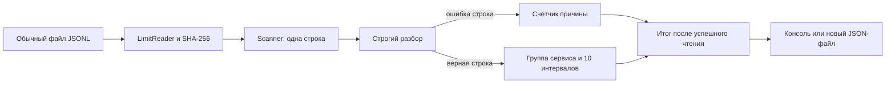

# Конспект: потоковая агрегация и приближённый p95 на Go

17 октября 2026 года, версия 0.1.0. Новый инструмент — Go 1.27.2.
[Запуск](README.md) · [Технологии](TECHNOLOGIES.md) · [Фактические проверки](VALIDATION.md).
Пример учебный: он не описывает коммерческий опыт или настоящую инфраструктуру.

## 1. Задача простыми словами

В файл записываются ответы трёх вымышленных сервисов. Каждая строка содержит имя
сервиса, HTTP-статус и длительность ответа. Нужно понять, сколько запросов пришло,
как часто сервер ошибается и насколько медленно отвечает. Файл может быть значительно
больше памяти, которую разумно отдать маленькому инструменту.

Проект читает очередную строку, проверяет её, обновляет несколько счётчиков и забывает
исходное событие. На выходе — небольшая JSON-сводка и русское объяснение в консоли.
Например, три ответа api с длительностями 100, 200 и 300 мс дают три запроса,
среднее 200 мс и верхнюю границу p95, равную 500 мс. Почему граница не равна 300,
разберём отдельно: это осознанное упрощение ради ограниченного состояния.

## 2. Что изучаем

После проекта на SQLite меняется способ хранения состояния. Вместо постоянной
истории есть один проход по файлу и небольшой набор агрегатов. В Go знакомимся
с интерфейсом io.Reader, буферизованным чтением, структурой результата, map групп
и явной обработкой ошибок. Из навыков дата-инженера важны кардинальность группировки,
качество входа, идемпотентность полного пересчёта и границы приближённых метрик.

Сервисов по умолчанию не больше 64. Если разрешить произвольное новое имя для каждой
строки, map разрастётся вместе с файлом и потоковое чтение перестанет помогать.
Ограничить нужно и длину строки, и число различных ключей, и размер состояния группы.
Точное хранение всех задержек или идентификаторов событий нарушило бы эту идею.

Go выбран ради простого исполняемого файла и прозрачной работы с Reader.
Сторонние библиотеки не нужны. Горoutines и параллельный пул здесь не добавлены:
они усложнили бы порядок ошибок и ограничение очередей, не решая обязательную задачу.
Параллельность стоит добавлять после измерения конкретного узкого места.

## 3. Данные и контракт

В JSONL один объект занимает одну физическую строку UTF-8. Поля строго три:
service, status и duration_ms. Имя сервиса ограничено 32 ASCII-символами,
статус находится в диапазоне 100–599, длительность — целое число 0–60 000 мс.
Времени события, пользователя, IP, URL и идентификатора запроса здесь нет.

Генератор создаёт 10 000 корректных строк по формулам от номера строки и добавляет
пять ошибок разных категорий. Результат воспроизводим без случайного seed.
Каждое двадцатое событие получает 503. Каждое двадцать пятое из оставшихся — 404.
Пересечение этих правил относится к 503, поэтому в демо 500 ответов 5xx и 300 ответов 4xx.
Длительность циклически идёт от 1 до 1000 мс, имена чередуются между тремя сервисами.

Строка с неверным значением отклоняется целиком. Число в кавычках не считается числом,
null не превращается в ноль, дробь и экспонента запрещены контрактом. Повтор одного
ключа также запрещён. Причина считается одним из пяти кодов, исходное содержимое
в карантин не записывается. Если ошибок несколько, учитывается первая найденная.

## 4. Архитектура и границы памяти



`internal/metrics/aggregate.go` принимает Reader и возвращает Summary.
`cmd/streammetrics/main.go` отвечает за параметры, файлы, демо и вывод.
Сценарий `scripts/smoke_check.py` собирает приложение и проверяет его снаружи.
Так алгоритм можно тестировать без настоящего большого файла.

Основное состояние оценивается как O(L + G × B), где L — предел строки,
G — предел сервисов, B — десять интервалов гистограммы. Итоговый JSON также зависит
от G и B. Количество прочитанных событий не входит в эту оценку.
Но она описывает наши структуры, а не весь RSS: разбор JSON временно выделяет память,
а среда Go управляет её освобождением. Это разные уровни измерения.

Вход ограничен 2 ГиБ и 100 млн строк. Scanner имеет явный предел буфера,
после завершения проверяется его ошибка. Без последней проверки слишком длинная
строка могла бы выглядеть как нормальный конец файла с неполным результатом.

## 5. Разбор трёх строк и гистограммы

Первая строка api, 200, 100 увеличивает число запросов, сумму длительностей
и счётчик интервала до 100 мс. Вторая строка api, 503, 200 дополнительно увеличивает
ошибки сервера и попадает в интервал до 250 мс. Третья строка api, 404, 300
увеличивает отдельный счётчик клиентских ошибок и интервал до 500 мс.
Итого среднее `(100 + 200 + 300) / 3 = 200`, доля 5xx — 33,33%.

Интервалы не накопительные. Первый включает 0–50, следующий — значения больше
50 и до 100 включительно. Для поиска p95 счётчики временно складываются слева направо,
пока сумма не достигнет нужного ранга. Целочисленная формула ранга:

```go
rank := (95*group.Requests + 99) / 100
```

Это ceil(0.95 × N). При N = 3 ранг равен 3, то есть нужен третий элемент
отсортированного набора. Он лежит в интервале до 500, поэтому возвращаем 500.
Точное значение nearest-rank p95 здесь 300. Верхняя граница — честная, но грубая оценка.
Уменьшить её ошибку можно более узкими интервалами, увеличив размер состояния.

В предыдущем проекте Polars использовалась линейная интерполяция: для этого набора
получалось 290. Сравнивать оба поля как одну и ту же точную метрику нельзя.
В этом проекте поле специально называется p95_upper_ms, а вывод использует знак ≤.
Среднее и процент округляются до двух знаков, значения интервалов остаются целыми.

Проверка повторных ключей устроена через чтение JSON-токенов. Имена складываются
в небольшую map, и второе появление уже известного имени отклоняется. Одного
преобразования JSON в структуру было бы недостаточно для такого правила контракта.
Дополнительно проверяются конец объекта и отсутствие второго JSON-значения в строке.

## 6. Повторы, ошибки и сохранение

Здесь нет удаления дублей. Две одинаковые корректные строки — два запроса.
Точная проверка всех ранее встреченных идентификаторов потребовала бы растущего
набора ключей или внешнего хранилища. Мы не добавляем такую возможность незаметно,
потому что она меняет и контракт, и расход памяти.

Повторный запуск читает файл с начала и создаёт новое состояние агрегатора.
Поэтому одинаковые байты и параметры дают одинаковую сводку, без прибавления
к прошлому результату. Это свойство полного пересчёта, а не гарантия exactly-once
для непрерывного потока. SHA-256 включает все прочитанные байты, в том числе
ошибочные строки и CRLF: он подтверждает байтовую идентичность входа.

Неверная строка увеличивает счётчик причины. Но ошибка чтения или превышение
предела групп отменяет весь результат. Продолжение после 65-го сервиса с лимитом 64
дало бы вводящую в заблуждение сводку, поэтому это фатальная ошибка.
Тест подаёт Reader, который сначала возвращает строку, а затем ошибку:
агрегатор должен вернуть ошибку и пустой результат без исходного текста исключения.

Сохранение начинается после успешного расчёта. O_CREATE вместе с O_EXCL не позволяет
заменить существующий файл, включая попытку записать результат поверх входа.
При обычной ошибке записи свой незавершённый файл закрывается и удаляется по возможности.
Тест искусственно пишет часть данных и возвращает ошибку, проверяя удаление файла.
Это не атомарная публикация: параллельный читатель может увидеть файл во время записи,
а принудительное завершение может оставить его незавершённым. Успех определяется
успешным завершением команды, а не одним наличием имени файла.

## 7. Как проверить

Команды README: `go run ./cmd/streammetrics demo`, затем `run` и `run -json`.
Соберите отдельный бинарный файл и проверьте, что он работает без команды go.
Сценарий smoke делает это автоматически во временной папке и сверяет сохранённый JSON.

Стандартный результат: 10 005 входных строк, 10 000 принятых, 5 отклонённых,
3 сервиса, 500 ответов 5xx и 300 ответов 4xx. При пороге 500 мс медленных событий
5010: значение ровно 500 включено, поэтому доля чуть больше половины.
Повтор должен дать тот же хэш и те же счётчики.

22 верхнеуровневые тестовые функции Go проверяют интервалы, контракт, Reader,
пределы и файловое поведение. Дополнительно есть проверки публикации на Python.
Особый Reader генерирует 100 000 строк и запрещает слишком большие запросы чтения.
Он помогает обнаружить случайный переход к полному чтению, но сам по себе
не измеряет максимальную память процесса.

## 8. Наблюдения при разработке

Первый набор тестов алгоритма прошёл без падений. Не придумываем историю исправления
необнаруженной ошибки. До сборки проверена среда: системный Go оказался версии 1.22.2,
поэтому актуальная 1.27.2 распакована локально с проверкой официальной контрольной суммы.
Обновлять глобальную установку не потребовалось.

Перед первым коммитом обнаружилась ошибка упаковочных настроек: правило
`streammetrics` в .gitignore скрывало не только бинарный файл, но и каталог исходников
`cmd/streammetrics`. Явное добавление списка файлов завершилось ошибкой, поэтому
неполный коммит не был создан. Правило исправлено на `/streammetrics`, применяемое
только в корне; состав отслеживаемых файлов сверяется с PUBLIC_FILES.txt.

На двух синтетических входах измерен максимальный RSS через GNU time.
Для 10 000 корректных строк, около 0,51 МБ, получилось 8668 КиБ.
Для миллиона строк, около 51,23 МБ, — 10176 КиБ. Увеличение входа примерно в сто раз
не вызвало стократного роста памяти в этом запуске. Это наблюдение одной среды,
а не доказательство универсального лимита. Суммарные выделения байтов за всё время
не подменяют максимум одновременно занятой памяти.

Во время подготовки публикации браузер потерял соединение с GitHub, затем подключение
GitHub тоже вернуло ошибку транспорта. Локальная готовность не считается опубликованным
релизом; фактическое состояние и незавершённые действия записаны в журнале серии.

## 9. Ограничения и следующий шаг

Нет временных окон, истории, коррекции поздних событий, точного перцентиля и точного
удаления дублей. Ключ группировки только один — сервис. Более подробная группировка
по URL или пользователю быстро увеличила бы кардинальность и могла бы включить
чувствительные данные. Настоящие журналы и их сводки не публикуются автоматически.

Не проверялись пределы 2 ГиБ, 100 млн строк и все 1024 группы одновременно.
Замер миллиона строк не заменяет стресс-тест, исследование отказов диска или аудит.
Следующий шаг — сравнить точный перцентиль маленького контрольного набора
с верхней границей гистограммы и обосновать нужную точность для конкретной задачи.

## 10. Вопросы и упражнения

Честное описание для собеседования: «На Go сделал учебный потоковый агрегатор JSONL,
ограничил размер строки и число групп, проверил Reader со сбоем и объяснил,
почему интервальная оценка p95 отличается от точного перцентиля».

Пять вопросов с короткими ответами:

- Достаточно ли читать построчно? Нет, map ключей и состояние группы тоже должны быть ограничены.
- Почему io.Reader полезен? Один алгоритм работает с файлом и искусственными источниками в тестах.
- Что хранит гистограмма? Число наблюдений в каждом фиксированном интервале, а не сами задержки.
- Где удаление дублей? Его нет; повторное событие учитывается снова согласно контракту.
- Почему недостаточно проверить Scan в цикле? После цикла нужно отличить нормальный EOF от ошибки Scanner.

Упражнения выполняйте на отдельном синтетическом файле:

1. Смените порог медленного запроса на 1000. В стандартном демо ожидаются 10 медленных
   событий: длительность 1000 встречается десять раз и включена в порог.
2. Подайте три строки api с длительностями 100, 200 и 300. Ожидаются среднее 200
   и p95_upper_ms = 500. Добавьте 60 000: новая граница p95 должна стать 60 000.
3. Повторите одну корректную строку дважды. Должны быть учтены два запроса.
   Объясните, какое хранилище добавили бы для точного удаления дублей.
4. Создайте два разных корректных сервиса и запустите с -max-services 1.
   Ожидается ошибка, новый файл результата не должен создаться.
5. В отдельной копии кода замените верхнюю границу 500 на 350, сохранив десять
   интервалов и их порядок. На наборе из упражнения 2 с тремя исходными строками
   граница p95 должна стать 350. Объясните компромисс точности и числа интервалов.

## 11. Источники

- [Официальные выпуски Go](https://go.dev/dl/?mode=json): версия 1.27.2 и SHA-256 архива,
  проверенные перед локальной установкой.
- [bufio](https://pkg.go.dev/bufio): Scanner, Buffer и проверка ошибки после чтения.
- [encoding/json](https://pkg.go.dev/encoding/json): Decoder, Token и разбор значений.
- [io](https://pkg.go.dev/io): Reader, LimitReader и TeeReader.
- [os](https://pkg.go.dev/os): OpenFile и исключительное создание.
- [testing](https://pkg.go.dev/testing): запуск тестов и подстановки входов.
- [GNU time](https://www.gnu.org/software/time/): инструмент локального измерения RSS.

Лимиты, интервалы, критерии ошибок и отказ от удаления дублей — решения этого проекта,
а не универсальные требования Go. Значения памяти получены собственным запуском.

Дополнение 19.10.2026: доступ восстановился, исходники опубликованы.
CI 39241706149 действительно выполнил проверки на Ubuntu и Windows; обе задачи успешны.
Сетевая ошибка задержала публикацию, но не требовала изменения кода конвейера.
